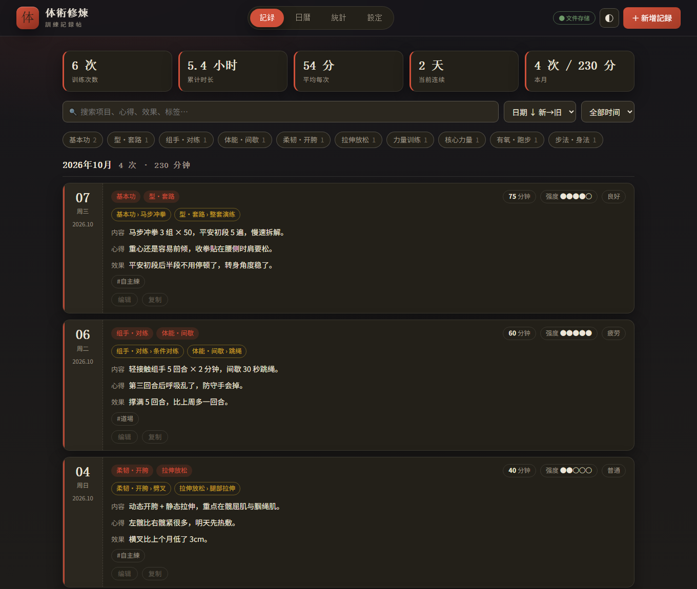
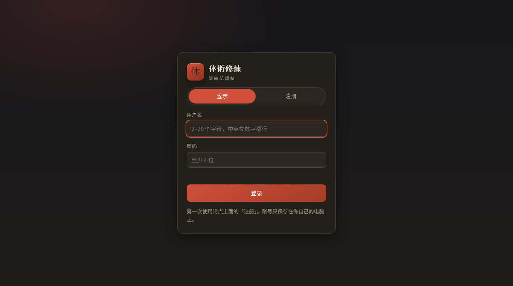
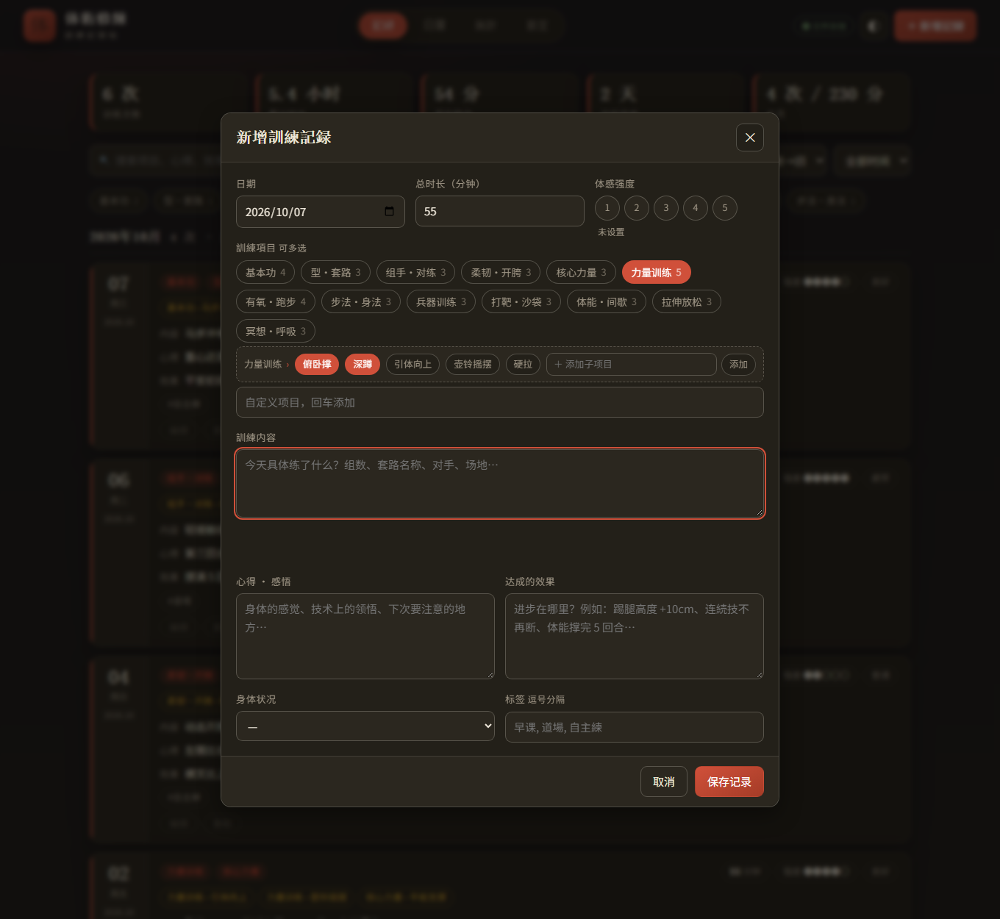

# 体術修煉 · 訓練記録帖

一个用来记录武术 / 体术训练的本地网页应用：**某年某月某日练了什么、练了多久、什么强度、当下的心得、取得的进步**，并把这些记录变成看得见的统计（连续天数、项目分布、修炼热力图）。

- 纯前端 + 零依赖，不需要安装任何第三方库
- **多账号**：用户名 + 密码注册登录，每人一份数据文件，互相看不见
- 数据保存在自己的电脑上（`data/` 目录或浏览器本地），不联网、不上传
- 电脑、手机浏览器都能用，窄屏会自动变成单列布局



---

## 一、三种打开方式

### 1. 双击 `start.bat`（推荐，Windows）
会自动启动本地服务并打开浏览器，地址是 <http://127.0.0.1:4173/>，进去先**注册一个账号**（只要用户名和密码）。
数据实时写入本目录的 **`data/<账号>.json`**，可复制、可网盘同步、可 Git 备份。
关闭那个黑窗口即停止服务（数据已经存好了）。

**端口被占用怎么办**：不会顺延到 4174，而是先"清掉占用"——如果占用者是本程序上一次没关掉的服务（或其它 node 进程），会先结束它再接管 4173；只有当占用者是**别的软件**时才会停手，并告诉你是哪个程序占的（避免误杀你正在用的软件）。

### 2. 手动启动服务
```bash
node server.mjs                 # 默认 http://127.0.0.1:4173/（不带 --open 时不会抢端口）
node server.mjs --open          # 启动后自动打开浏览器（start.bat 用的就是这个）
node server.mjs --port 8080     # 换端口
node server.mjs --host 0.0.0.0  # 允许局域网内其它设备访问（手机、平板）
node server.mjs --data-dir D:\my-data   # 换个地方存账号和数据
```

### 3. 直接双击 `index.html`
完全不依赖服务，可以记，但**没有账号系统**（.bat 里没装 Node 时也会退到这条路）：
数据存在**浏览器本地存储**里，请定期用「設定 → 导出 JSON 备份」。
想要账号和多人隔离，就用上面两种方式从 `http://127.0.0.1:4173/` 打开。

> 顶部右上角的角标会告诉你当前是「● 文件存储」还是「● 浏览器存储」，旁边是当前账号名。



---

## 二、账号系统

- **注册**：用户名 2–20 个字符（中英文、数字、下划线、点、减号）。**密码只要填了就行——1 位也可以，不限制字符和长度**。用户名不区分大小写（`Alice` 和 `alice` 是同一个账号）。
- **登录**：登录状态保存在 `HttpOnly` Cookie 里，默认 30 天有效，关掉浏览器再打开不用重新登录。
- **改密码**：右上角 ⚿ 按钮，输入原密码 + 新密码；改完会重新验证。
- **退出登录**：右上角 ⎋ 按钮，退出后需要重新输入密码才能看到记录。
- **多人隔离**：每个账号一份 `data/<账号id>.json`，服务端按会话判断身份，别人拿不到你的数据（未登录访问接口一律 401）。
- **忘记密码**：先关掉服务，在目录里执行（密码改完旧会话全部失效）：
  ```bash
  node reset-password.mjs --list              # 看有哪些账号
  node reset-password.mjs 用户名 新密码        # 重置密码（记录不动）
  ```
- **从旧版本升级**：老版本的单用户 `data.json` 会被**第一个注册的账号自动接管**（只复制、不删原文件，原文件留作备份）。之后的账号都是全新的空账号。

### 安全说明（如实说）
- 密码用 Node 内置 `scrypt` + 每人随机盐做散列，`data/users.json` 里只有 `salt` 和 `hash`，**不存明文**；校验用时间安全比较。
- 连续输错 5 次会锁定该用户名 30 秒，挡住暴力猜测。
- 会话 ID 是 32 字节随机数，存在 `data/sessions.json`，服务重启也不会掉登录。
- 默认只监听 `127.0.0.1`（只有本机能访问）。如果加 `--host 0.0.0.0` 给局域网用，请注意：这是 **HTTP 明文**，同一网络里的人可以抓包看到密码和内容——只在可信网络里这么用，别暴露到公网。

---

## 三、四个视图

| 视图 | 用途 |
| --- | --- |
| **記録** | 按月份倒序列出所有训练卡片：项目与子项目标签（带个数）、时长、强度、身体状况、内容、心得、效果、自定义标签。支持关键词搜索、按项目筛选、时间范围（近 30/90/365 天）、正倒序切换。 |
| **日暦** | 月历。练过的日子会着色并显示当天总时长，点某一天查看当天全部记录，或直接「在这天新增」。 |
| **統計** | 训练次数、累计时长、累计个数、训练天数、当前/最长连续、本月对比上月、平均每次时长、平均强度、项目分布（含子项目明细）、近 12 周修炼热力图、近 30 天时长柱状图。 |
| **設定** | 管理项目与子项目、查看存储方式、导出 JSON / Markdown / CSV、导入恢复、载入示例数据、清空数据。 |

### 项目可以分层
「力量训练」这样的**项目**下面可以有**子项目**，例如 俯卧撑、深蹲、引体向上：



- **记的时候**：在编辑窗选中「力量训练」，它下面立刻出现一行子项目，点一下就能勾选（可多选）；勾选后每个子项目旁边会出现一个「个数」小框，用来填引体向上 8 个、俯卧撑 30 个这类次数；点这一行里的「＋ 添加子项目」可以当场新建，新建后自动选中。
- **个数填在哪**：看这个项目**有没有子项目**——有子项目的（如「力量训练」）个数填在它的子项目上；没有子项目的（如新建的「引体向上」）直接填在项目本身的小框里。项目按钮右上角的小数字就是它有几个子项目。
- **删的时候**：编辑窗里勾选任意项目 / 子项目后会出现 ✕，点它就能从项目清单里删除（不影响已有记录）；設定页也能删项目与子项目。
- **管的时候**：設定页每个项目卡片里能看到它的全部子项目，点子项目上的 ✕ 删除，底部输入框回车添加。
- **看统计时**：「项目分布」里每个项目下面用 `↳` 列出它的子项目次数、时长与累计个数，还多了一个「涉及子项目」的计数。
- 搜索框输入子项目名（例如「俯卧撑」）就能筛出练过它的记录。
- 项目按钮右上角的小数字是它有几个子项目。默认项目都自带常用的子项目（力量训练 → 俯卧撑/深蹲/…），你可以随意增删。

### 记录里有什么字段
日期（必填）、训练项目（可多选、可自定义）、**子项目**（可多选、可当场新建）、总时长（分钟）、**个数**（每个项目 / 子项目分别填，例如引体向上 8 个、俯卧撑 30 个；没有子项目的自定义项目也能填）、体感强度（1–5）、训练内容、心得、达成的效果、身体状况、标签。

### 快捷键
| 按键 | 作用 |
| --- | --- |
| <kbd>N</kbd> | 新增记录 |
| <kbd>/</kbd> | 跳到記録页并聚焦搜索框 |
| <kbd>Esc</kbd> | 关闭编辑窗 |

### 小技巧
- 卡片上的「复制」会以**今天**为日期、沿用那条记录的项目、子项目与内容，适合每天都练同一套的情况。
- 日暦页点日期 → 「在这天新增」，会自动带上那天的日期。
- 在「訓練項目」输入框里按回车可以现场新增项目，并会加入项目清单。

---

## 三、数据与备份

数据都在 `data/` 目录里：

```
data/
├─ users.json        账号：用户名 + 盐 + scrypt 散列（没有明文密码）
├─ sessions.json     登录会话（删掉它 = 所有人都要重新登录）
└─ <账号id>.json      这个账号的全部训练记录
```

`<账号id>.json` 结构很简单，出问题可以手改，也可以自己写脚本处理（子项目是 `{parent, name, count?}`，项目是 `{name, children}`）：

```json
{
  "version": 1,
  "settings": {
    "theme": "dark",
    "items": [
      { "name": "基本功", "children": ["马步冲拳", "基本步法"] },
      { "name": "力量训练", "children": ["俯卧撑", "深蹲", "引体向上"] }
    ]
  },
  "records": [
    {
      "id": "…", "date": "2026-10-07",
      "items": ["力量训练"],
      "itemCounts": { "力量训练": 30 },
      "subItems": [{ "parent": "力量训练", "name": "俯卧撑", "count": 60 }],
      "minutes": 75, "intensity": 4,
      "content": "俯卧撑 4 组 × 20，深蹲 3 组 × 15。",
      "insight": "核心要收紧。",
      "effect": "俯卧撑从 15 个到 20 个。",
      "condition": "良好", "tags": ["自主練"],
      "createdAt": "…", "updatedAt": "…"
    }
  ]
}
```

- 老版本只有 `"items": ["力量训练"]` 这种扁平写法，打开时会**自动升级**成项目树，并补上该项目默认的子项目；已有记录不会被动过。
- 每次写入前，服务会把上一版另存为 `<账号id>.json.bak`。
- **备份**：整个 `data/` 目录复制走就是完整备份（含账号）；只想备份记录的话，用「設定 → 导出 JSON 备份」。
- 「导入」是**合并**语义：同 `id` 覆盖，新 `id` 追加，同名项目的子项目取并集，不会删除已有记录。所以「导出 → 改一改 → 导入」是安全的。
- 导出的 Markdown 适合贴进日记 / Notion（子项目写成 `力量训练（力量训练›俯卧撑×60）`），CSV 多了「子项目」「个数」两列，适合丢进 Excel 做图表。

---

## 四、目录结构

```
taijutsu-shuren/
├─ index.html            页面骨架（登录 / 四个视图 / 编辑弹窗）
├─ styles.css            主题样式（暗色「道場」/ 亮色「和纸」）
├─ js/
│  ├─ core.js            纯逻辑：规格化、筛选、统计、连续天数、导出（可在 Node 里跑）
│  ├─ store.js           持久化：账号会话 + 文件存储 / 浏览器存储自动切换
│  └─ app.js             视图渲染与交互
├─ auth.mjs              账号纯逻辑：用户名/密码校验、scrypt 散列、令牌、失败限流
├─ server.mjs            零依赖本地服务（静态文件 + 账号 + 每人一份数据）
├─ reset-password.mjs    忘记密码时重置（要先停服务）
├─ start.bat             Windows 一键启动
├─ tests/                自检脚本（见下）
├─ data/                 账号与数据（首次启动自动创建）
└─ data.json             老版本的单用户数据，会被第一个注册的账号接管，之后留作备份
```

## 五、自检与测试

```bash
node tests/auth.test.cjs      # 8 项：用户名/密码校验、散列与校验、令牌、失败限流
node tests/core.test.cjs      # 32 项：日期、连续天数、统计、项目树/子项目、个数、导出、导入
node tests/e2e.cjs            # 83 项：无头浏览器真跑一遍注册/登录/登出、增删改查、子项目、个数、四个视图、落盘

# 22 项接口测试：先起一个用临时账号库的测试服务，再跑
node server.mjs --port 4188 --data-dir tests/.tmp-data --legacy tests/.tmp-legacy.json
node tests/server.test.cjs     # 另一个终端
```

`tests/server.test.cjs` 与 `tests/e2e.cjs` 都用**临时账号库和数据目录**，跑完自动清理，
不会碰你的 `data/` 与 `data.json`。（e2e 需要本机有 Chrome 或 Edge，可用 `CHROME_PATH` 指定。）

## 六、想改点什么

- **换配色**：改 `styles.css` 顶部的 `:root` / `html[data-theme="light"]` 变量，`--accent` 是主色（当前是朱红），`--gold` 是辅助色（子项目用它）。
- **默认项目与子项目**：改 `js/core.js` 顶部的 `DEFAULT_ITEM_TREE`（`{ name, children }`）；你自己的项目清单存在各账号数据文件的 `settings.items`。
- **身体状况选项**：改 `js/core.js` 里的 `CONDITIONS`。
- **账号规则**（用户名长度、密码要求、会话天数、失败锁定）：改 `auth.mjs` 顶部的常量（`PASSWORD_MIN` 现在就是 1）。
- **想加字段**（比如「对手」「场地」「体重」）：在 `js/core.js` 的 `normalizeRecord` 加字段、在 `index.html` 的弹窗里加输入框、在 `js/app.js` 的 `openEditor` / `submitEditor` / `recordCardHTML` 里补上读取与显示即可。
- **想做三层以上**（项目 › 子项目 › 动作细节）：目前固定两层，`children` 是字符串数组；要更深可以把 `children` 改成同样的 `{name, children}` 结构，改 `normalizeItems` / `itemChildren` 两处即可。

## 七、许可证

[MIT](LICENSE)。`data/`、`data.json` 等本地数据已在 `.gitignore` 中排除，不会进入仓库。
